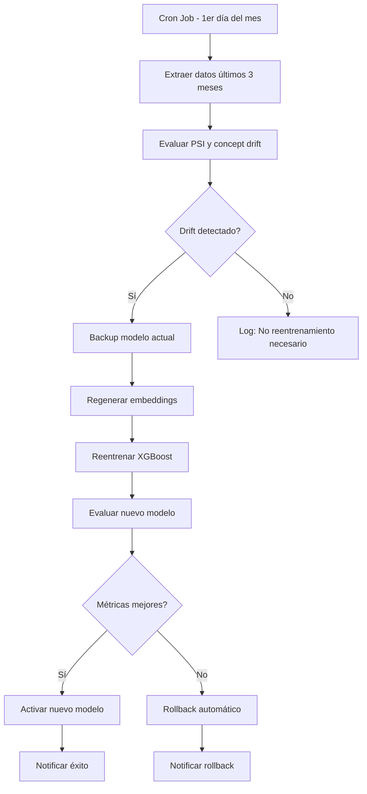

# 10. INTEGRACIÓN LLM LOCAL — Fase 8

> **Propósito:** Documentación técnica de la integración de modelos de lenguaje locales para enriquecimiento semántico del pipeline de auditoría prestacional.

## RESUMEN EJECUTIVO

**Objetivo:** Superar el Recall Glosada actual de 0.7261 a ≥0.80 mediante enriquecimiento semántico del vector de features, manteniendo el modelo XGBoost v1 como base irremplazable y cumplimiento estricto con la Ley 1581 de Colombia.

**Enfoque:** Integración 100% local usando Ollama + Sentence Transformers + spaCy para:
1. **Enriquecimiento de features** con embeddings semánticos de campos textuales clínicos
2. **Generación de explicaciones** en lenguaje natural contextualizadas con Resolución 2284/2023

**Estado:** 54% completado (7/13 tareas principales)

---

## ARQUITECTURA DE LA INTEGRACIÓN

### Componentes Implementados ✅

#### 1. PrivacyGuard (`src/privacy/guard.py`)
- **Propósito:** Garantizar cumplimiento Ley 1581 de Colombia
- **Funciones:**
  - `verify_local_only()`: Valida que Ollama opere solo en localhost
  - `check_ollama_available()`: Verifica disponibilidad del servidor
  - `log_inference()`: Logging seguro sin contenido textual

#### 2. NLP Pipeline (`src/nlp/pipeline.py`)
- **Propósito:** Preprocesamiento de texto clínico en español
- **Funciones:**
  - `load_nlp_pipeline()`: Carga spaCy `es_core_news_md` con caché singleton
  - `preprocess_text()`: Tokenización, normalización, eliminación de stopwords médicos
- **Stopwords médicos:** "paciente", "presenta", "refiere", etc.

#### 3. EmbeddingService (`src/embeddings/service.py`)
- **Propósito:** Generación de vectores semánticos con Sentence Transformers
- **Funciones:**
  - `encode()`: Vector de dimensión fija para texto individual
  - `encode_batch()`: Procesamiento vectorizado
  - `zero_vector()`: Vector de ceros para campos nulos
- **Null-handling:** Campos vacíos → vector de ceros sin invocar modelo

#### 4. EmbeddingPipeline (`src/features/embedding_pipeline.py`)
- **Propósito:** Enriquecimiento del vector de 48 features numéricas
- **Funciones:**
  - `build_text_fields()`: Extrae campos textuales clínicos
  - `enrich_features()`: Concatena embeddings al vector numérico
  - `generate_split_embeddings()`: Respeta división temporal (sin shuffle)
  - `save_embeddings()` / `load_embeddings()`: Serialización NPZ comprimida
- **Campos textuales:** `diagnostico_texto`, `cups_texto`, `observaciones`

#### 5. LLMEvaluator (`src/evaluation/llm_evaluator.py`)
- **Propósito:** Evaluación experimental de candidatos LLM
- **Funciones:**
  - `evaluate_candidate()`: Métricas de negocio (Recall Glosada, F1-macro, AUC-ROC)
  - `measure_embedding_separability()`: Silhouette score entre clases
  - `measure_latency()`: Percentiles p50/p95 de inferencia
  - `run_full_evaluation()`: Reporte JSON comparativo con recomendación
- **Candidatos:** Llama 3.2, Mistral 7B, Qwen2.5, Phi-3 Mini
- **Lógica de resultado negativo:** Si ningún candidato supera baseline → recomendar pipeline base

### Componentes Pendientes ⏳

#### 6. ExplanationGenerator (`src/explainability/explanation_generator.py`)
- **Propósito:** Narrativas en lenguaje natural para auditores médicos
- **Funcionalidad esperada:**
  - Explicaciones en español contextualizadas con Res. 2284/2023
  - Degradación graciosa si Ollama no disponible
  - Evitar términos técnicos de ML ("SHAP", "embedding", "feature importance")

#### 7. DriftDetector (`src/monitoring/drift_detector.py`)
- **Propósito:** Monitoreo de concept drift con PSI
- **Funcionalidad esperada:**
  - `compute_psi()`: Population Stability Index
  - `compute_embedding_psi()`: PSI por dimensión reducida (PCA)
  - `check_drift()`: Niveles "stable", "warning", "alert"

#### 8. Integración API FastAPI
- **Extensión de schemas:** Campos textuales opcionales en `PredictionRequest`
- **Nuevo endpoint:** `GET /v1/llm/status`
- **Compatibilidad:** Mantener contratos existentes sin cambios

---

## ESPECIFICACIÓN TÉCNICA

### Ubicación de la Spec
- **Directorio:** `.kiro/specs/local-llm-integration/`
- **Tipo:** Feature spec (design-first workflow)
- **Archivos:**
  - `requirements.md`: 8 requisitos funcionales detallados
  - `design.md`: Arquitectura y componentes
  - `tasks.md`: 13 tareas de implementación con criterios de aceptación

### Requisitos Clave

#### R1: Infraestructura LLM Local y Cumplimiento Ley 1581
- Toda inferencia 100% local (Ollama + Sentence Transformers)
- PrivacyGuard bloquea transmisión de datos clínicos a servicios externos
- Logging seguro sin contenido textual

#### R2: Enriquecimiento de Features con Embeddings Semánticos
- Concatenar embeddings al vector de 48 features numéricas
- Preservar división temporal (nunca aleatoria por `fecha_radicacion`)
- Null-handling: campos vacíos → vector de ceros

#### R3: Evaluación Experimental de Modelos LLM Candidatos
- Evaluar 4 candidatos en métricas de negocio
- Medir separabilidad semántica y latencia
- Reporte JSON con recomendación justificada

#### R6: Métricas de Éxito
- **Criterio primario:** Recall Glosada ≥ 0.80 en test set
- **Degradación máxima permitida:** F1-macro ≥ 0.7290, AUC-ROC ≥ 0.8978
- Mantener tarea multiclase (3 clases) siempre

### Configuración Técnica

#### Constantes LLM (`src/config.py`)
```python
OLLAMA_BASE_URL = "http://localhost:11434"
EMBEDDING_MODEL_NAME = "sentence-transformers/paraphrase-multilingual-MiniLM-L12-v2"
EMBEDDING_DIM = 384
OLLAMA_TIMEOUT_S = 30.0
PSI_DRIFT_WARN_THRESHOLD = 0.20
PSI_DRIFT_ALERT_THRESHOLD = 0.15
LLM_CANDIDATES = ["llama3.2", "mistral", "qwen2.5", "phi3"]
EXPLANATION_MAX_SECONDS = 10.0
```

#### Dependencias Adicionales
```txt
sentence-transformers>=2.2.0
spacy>=3.7.0
ollama>=0.1.0
scipy>=1.11.0  # Para PSI
```

#### Instalación spaCy
```bash
python -m spacy download es_core_news_md
```

#### Instalación Ollama
```bash
# Descargar e instalar Ollama
curl -fsSL https://ollama.ai/install.sh | sh

# Descargar modelos candidatos
ollama pull llama3.2
ollama pull mistral
ollama pull qwen2.5
ollama pull phi3
```

---

## METODOLOGÍA DE DESARROLLO

### Property-Based Testing
- **8 propiedades definidas** para validar correctness
- Ejemplos:
  - P1: Idempotencia del preprocesamiento NLP
  - P2: Dimensión fija de embeddings
  - P3: Vector cero para inputs nulos
  - P4: Dimensión del vector enriquecido
  - P5: No data leakage temporal

### Reproducibilidad
- `RANDOM_STATE = 42` en todos los componentes
- División temporal fija (nunca aleatoria)
- Serialización determinística de artefactos

### Cumplimiento Regulatorio
- **Ley 1581 de Colombia:** Datos clínicos nunca salen de infraestructura local
- **Resolución 2284/2023:** Causales de glosas integrados en explicaciones
- Logging sin contenido textual de datos sensibles

---

## PROGRESO ACTUAL

### Tareas Completadas (7/16)
1. ✅ Infraestructura y dependencias LLM local
2. ✅ Privacy Guard (implementación)
3. ✅ NLP Pipeline con spaCy (implementación)
4. ✅ Embedding Service (implementación)
5. ✅ Checkpoint intermedio (tests existentes pasan)
6. ✅ Embedding Pipeline (implementación)
7. ✅ LLM Evaluator (implementación)

### Tareas en Progreso (1/16)
- 🔄 Reentrenamiento XGBoost con features enriquecidas

### Tareas Pendientes (8/16)
- Tests unitarios y property tests para componentes implementados
- Generador de explicaciones en lenguaje natural
- Monitoreo de concept drift con PSI
- Integración con API FastAPI
- Artefactos experimentales y reproducibilidad
- **Sistema de reentrenamiento automático y monitoreo continuo**
- **Demo MVP con interfaz gráfica atractiva (Streamlit)**

### Próximos Pasos Inmediatos
1. Completar tests unitarios para PrivacyGuard, NLP Pipeline, EmbeddingService
2. Finalizar script de reentrenamiento XGBoost
3. Implementar ExplanationGenerator con degradación graciosa
4. **Implementar sistema de reentrenamiento automático mensual**
5. Extender API FastAPI manteniendo compatibilidad hacia atrás
6. **Crear Demo MVP con interfaz gráfica atractiva usando Streamlit**

---

## SISTEMA DE REENTRENAMIENTO AUTOMÁTICO

### Objetivo del Sistema
Implementar un sistema robusto de reentrenamiento automático que mantenga el modelo actualizado con datos recientes, detecte concept drift, y permita rollback seguro a versiones anteriores.

### Componentes del Sistema de Reentrenamiento

#### 1. RetrainingScheduler (`src/training/retraining_scheduler.py`)
- **Reentrenamiento programado:** Cada primer día del mes automáticamente
- **Detección de drift:** Evaluación PSI mensual con umbrales configurables
- **Extracción de datos recientes:** Últimos 3 meses por defecto
- **Backup automático:** Respaldo del modelo actual antes de reentrenar
- **Validación cruzada:** Comparación de métricas nuevo vs actual

#### 2. ModelMonitor (`src/monitoring/model_monitor.py`)
- **Tracking continuo:** Almacenamiento de métricas diarias en SQLite
- **Reportes mensuales:** Análisis de degradación y tendencias
- **Alertas automáticas:** Notificación cuando F1-macro o Recall Glosada caen >5%
- **Dashboard de métricas:** Visualización de tendencias temporales

#### 3. Endpoints Administrativos (FastAPI)
- `POST /v1/admin/retrain` - Reentrenamiento manual
- `GET /v1/admin/model/metrics` - Métricas del modelo actual
- `GET /v1/admin/drift/status` - Estado de concept drift
- `POST /v1/admin/model/rollback` - Rollback a versión anterior

#### 4. Model Registry (`src/storage/model_registry.py`)
- **Versionado de modelos:** Registro con timestamps y métricas
- **Metadata completa:** model_id, version, metrics, created_at, is_active
- **Carga por versión:** Capacidad de cargar cualquier versión histórica
- **Comparación de versiones:** Análisis lado a lado de métricas

#### 5. Automatización y Cron Jobs
- **Script mensual:** `scripts/monthly_retrain.py`
- **Configuración cron:** Ejecución automática primer día de cada mes
- **Notificaciones:** Email/Slack cuando reentrenamiento completa
- **Rollback automático:** Si nuevo modelo tiene métricas inferiores

#### 6. Dashboard Administrativo
- **Interfaz web:** Flask/Streamlit para administración
- **Métricas históricas:** Visualización de tendencias y drift
- **Control manual:** Botones para reentrenamiento y rollback
- **Logs detallados:** Historial de reentrenamientos y alertas

### Flujo de Reentrenamiento Automático



### Beneficios del Sistema
1. **Mantenimiento automático:** Sin intervención manual mensual
2. **Detección temprana:** Alertas de degradación antes de impacto crítico
3. **Seguridad:** Rollback automático si nuevo modelo es inferior
4. **Trazabilidad:** Registro completo de versiones y cambios
5. **Monitoreo continuo:** Dashboard con métricas en tiempo real
6. **Escalabilidad:** Fácil ajuste de frecuencia y umbrales

---

## DEMO MVP - INTERFAZ GRÁFICA ATRACTIVA

### Objetivo del Demo
Crear una interfaz web moderna y visualmente atractiva que demuestre las capacidades de la integración LLM local de manera intuitiva para stakeholders técnicos y de negocio.

### Tecnología: Streamlit
- **Framework:** Streamlit para desarrollo rápido de interfaces web
- **Diseño:** Moderno, responsive, tema corporativo de Savia Salud EPS
- **Interactividad:** Gráficos dinámicos con Plotly, componentes interactivos

### Funcionalidades del Demo

#### 1. Dashboard Principal
- **Layout:** Sidebar para configuración + área principal para resultados
- **Métricas en tiempo real:** Latencia, confianza, estado de Ollama
- **Tema configurable:** Modo oscuro/claro con paleta corporativa

#### 2. Entrada de Datos Intuitiva
- **Formulario estructurado:** 48 features numéricas organizadas por categorías
- **Campos textuales opcionales:** Diagnóstico CIE-10, códigos CUPS, observaciones
- **Validación en tiempo real:** Feedback inmediato sobre datos ingresados
- **Casos precargados:** Ejemplos demostrativos listos para usar

#### 3. Predicción Comparativa
- **Vista lado a lado:** Modelo base vs modelo enriquecido
- **Métricas de confianza:** Probabilidades por clase con visualización
- **Tiempo de respuesta:** Comparación de latencias entre modelos
- **Indicadores visuales:** Colores y iconos para diferentes tipos de predicción

#### 4. Explicaciones Enriquecidas
- **Narrativas en lenguaje natural:** Explicaciones contextualizadas con Res. 2284/2023
- **Factores de riesgo:** Top-3 features más importantes con interpretación
- **Causales de glosas:** Referencias específicas a códigos regulatorios
- **Comparación:** Explicación técnica SHAP vs narrativa enriquecida

#### 5. Visualizaciones Interactivas
- **Gráficos de embeddings:** Visualización 2D/3D de separabilidad semántica
- **SHAP plots:** Importancia de features con interpretación visual
- **Métricas de drift:** PSI y alertas de concept drift
- **Distribuciones:** Comparación entre conjuntos de entrenamiento y test

#### 6. Panel de Monitoreo del Sistema
- **Estado de Ollama:** Disponibilidad, modelos cargados, versiones
- **Métricas de rendimiento:** Latencias p50/p95, throughput
- **Alertas de drift:** Warnings y alerts con recomendaciones
- **Logs de inferencia:** Historial de predicciones (sin datos sensibles)

### Casos de Uso Demostrativos

#### Caso 1: Factura Estándar (Modelo Base)
- Datos: Solo features numéricas, sin campos textuales
- Demostración: Pipeline tradicional XGBoost
- Resultado: Predicción base con explicación SHAP técnica

#### Caso 2: Diagnóstico Complejo (Enriquecimiento Semántico)
- Datos: Diagnóstico CIE-10 complejo (ej. "Insuficiencia cardíaca congestiva con complicaciones")
- Demostración: Enriquecimiento con embeddings semánticos
- Resultado: Mejora en confianza y precisión de predicción

#### Caso 3: Observaciones Clínicas (Explicación Enriquecida)
- Datos: Observaciones detalladas del auditor médico
- Demostración: Generación de explicación en lenguaje natural
- Resultado: Narrativa contextualizada con causales Res. 2284/2023

#### Caso 4: Simulación de Concept Drift
- Datos: Facturas con patrones fuera de distribución de entrenamiento
- Demostración: Detección de drift con PSI
- Resultado: Alertas y recomendaciones de reentrenamiento

### Elementos Visuales Atractivos

#### Paleta de Colores Corporativa
- **Primario:** Verde Savia Salud (#2E8B57)
- **Secundario:** Azul corporativo (#1E90FF)
- **Acentos:** Naranja para alertas (#FF8C00), Rojo para errores (#DC143C)
- **Neutros:** Grises modernos para texto y fondos

#### Iconografía y Elementos Gráficos
- **Iconos médicos:** Estetoscopio, cruz médica, documentos clínicos
- **Indicadores de estado:** Semáforos, progress bars, badges
- **Animaciones sutiles:** Loading spinners, transiciones suaves
- **Cards modernas:** Bordes redondeados, sombras, efectos hover

#### Tipografía y Layout
- **Fuente:** Inter o Roboto para legibilidad
- **Jerarquía visual:** Títulos claros, subtítulos, texto de apoyo
- **Espaciado:** Generous whitespace, padding consistente
- **Responsive:** Adaptable a diferentes tamaños de pantalla

### Estructura de Archivos del Demo
```
Codigo/demo/
├── streamlit_app.py          ← Aplicación principal
├── components/               ← Componentes reutilizables
│   ├── sidebar.py           ← Configuración y navegación
│   ├── prediction_panel.py  ← Panel de predicciones
│   ├── explanation_panel.py ← Panel de explicaciones
│   └── monitoring_panel.py  ← Panel de monitoreo
├── utils/                   ← Utilidades del demo
│   ├── data_generator.py    ← Generación de datos sintéticos
│   ├── visualization.py    ← Gráficos y visualizaciones
│   └── styling.py          ← CSS y estilos personalizados
├── assets/                  ← Recursos estáticos
│   ├── logo_savia.png      ← Logo corporativo
│   ├── icons/              ← Iconos personalizados
│   └── styles.css          ← Estilos CSS adicionales
├── data/                   ← Datos de demostración
│   └── demo_cases.json     ← Casos de uso precargados
├── Dockerfile              ← Containerización del demo
└── README.md               ← Documentación específica
```

### Dependencias Adicionales para el Demo
```txt
streamlit>=1.28.0
plotly>=5.17.0
streamlit-option-menu>=0.3.6
streamlit-card>=0.0.4
streamlit-elements>=0.1.0
pillow>=10.0.0
```

---

## ARCHIVOS CLAVE

### Implementación
- `src/privacy/guard.py` - PrivacyGuard (completado)
- `src/nlp/pipeline.py` - NLP Pipeline (completado)
- `src/embeddings/service.py` - EmbeddingService (completado)
- `src/features/embedding_pipeline.py` - EmbeddingPipeline (completado)
- `src/evaluation/llm_evaluator.py` - LLMEvaluator (completado)
- `src/evaluation/retrain_xgboost.py` - Reentrenamiento (en progreso)

### Sistema de Reentrenamiento Automático (pendiente)
- `src/training/retraining_scheduler.py` - Programador de reentrenamiento
- `src/monitoring/model_monitor.py` - Monitor de métricas continuas
- `src/storage/model_registry.py` - Registro y versionado de modelos
- `scripts/monthly_retrain.py` - Script de reentrenamiento mensual
- `admin/dashboard.py` - Dashboard administrativo

### Demo MVP
- `demo/streamlit_app.py` - Aplicación principal del demo (pendiente)
- `demo/components/` - Componentes reutilizables de la interfaz (pendiente)
- `demo/utils/` - Utilidades para visualización y datos sintéticos (pendiente)
- `demo/assets/` - Recursos estáticos (logos, iconos, estilos) (pendiente)

### Especificación
- `.kiro/specs/local-llm-integration/requirements.md` - Requisitos detallados
- `.kiro/specs/local-llm-integration/design.md` - Arquitectura
- `.kiro/specs/local-llm-integration/tasks.md` - Plan de implementación

### Testing (pendiente)
- `tests/test_privacy_guard.py`
- `tests/test_nlp_pipeline.py`
- `tests/test_embedding_service.py`
- `tests/test_embedding_pipeline.py`
- `tests/test_llm_evaluator.py`

---

*Última actualización: 2026-04-09*