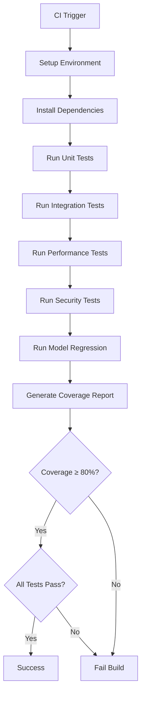

# Design Document: API Testing Suite

## Overview

La suite de pruebas de validación (api-testing-suite) es un sistema integral de testing automatizado que verifica la corrección, performance, seguridad y confiabilidad de la API REST de clasificación predictiva de facturas médicas. La suite implementa una estrategia de testing multi-capa que cubre desde tests unitarios de componentes individuales hasta tests de integración end-to-end, performance bajo carga, y validación de regresión del modelo ML.

El sistema bajo prueba es una API FastAPI que expone un modelo XGBoost v1 (F1-macro=0.749, AUC=0.908) con 4 endpoints principales, validación estricta de 48 features mediante Pydantic v2, y explicabilidad SHAP en tiempo real. La suite debe ejecutarse en menos de 5 minutos, alcanzar cobertura mínima del 80%, y ser compatible con pipelines de CI/CD (GitHub Actions, GitLab CI, Jenkins).

### Key Design Goals

1. **Comprehensive Coverage**: Validar todos los módulos críticos (features, predict, explainability, API) con cobertura ≥80%
2. **Fast Execution**: Completar toda la suite en <5 minutos para feedback rápido en CI/CD
3. **Isolation**: Tests unitarios con mocking apropiado para independencia de artefactos externos
4. **Realistic Integration**: Tests de integración con modelo real para validar comportamiento end-to-end
5. **Performance Validation**: Verificar latencias objetivo (<500ms tiempo real, <200ms/factura batch)
6. **Model Regression Protection**: Detectar degradación de métricas ML (F1, Recall, AUC)
7. **Security Hardening**: Validar manejo seguro de inputs maliciosos y edge cases

## Architecture

### Testing Layers

La suite implementa una arquitectura de testing en 6 capas:

```
┌─────────────────────────────────────────────────────────────┐
│                    CI/CD Pipeline Layer                      │
│  (GitHub Actions, pytest execution, coverage reporting)      │
└─────────────────────────────────────────────────────────────┘
                              │
┌─────────────────────────────────────────────────────────────┐
│                   Test Orchestration Layer                   │
│  (pytest, fixtures, markers, parallel execution)             │
└─────────────────────────────────────────────────────────────┘
                              │
        ┌─────────────────────┼─────────────────────┐
        │                     │                     │
┌───────▼────────┐  ┌────────▼────────┐  ┌────────▼────────┐
│  Unit Tests    │  │ Integration     │  │  Performance    │
│  (isolated)    │  │ Tests (e2e)     │  │  Tests (load)   │
└────────────────┘  └─────────────────┘  └─────────────────┘
        │                     │                     │
┌───────▼────────┐  ┌────────▼────────┐  ┌────────▼────────┐
│  Security      │  │ Model           │  │  Docker         │
│  Tests         │  │ Regression      │  │  Tests          │
└────────────────┘  └─────────────────┘  └─────────────────┘
```

### Test Organization Structure

```
Codigo/tests/
├── conftest.py                    # Shared fixtures (session, module, function scopes)
├── pytest.ini                     # Pytest configuration, markers, coverage settings
├── test_features.py               # Unit tests for features.engineering module
├── test_predict.py                # Unit tests for models.predict module
├── test_explainability.py         # Unit tests for explainability.shap_explanations
├── test_schemas.py                # Unit tests for api.schemas validation
├── test_api.py                    # Integration tests for API endpoints
├── test_performance.py            # Performance and load tests
├── test_security.py               # Security and input validation tests
├── test_model_regression.py       # Model metrics regression tests
├── test_docker.py                 # Docker container tests
└── fixtures/
    ├── sample_data.py             # Test data factories
    ├── mock_models.py             # Mock model artifacts
    └── api_payloads.py            # API request/response fixtures
```

### Test Execution Flow



## Components and Interfaces

### 1. Test Fixtures (conftest.py)

**Purpose**: Provide reusable test data and setup/teardown logic across all test modules.

**Key Fixtures**:

```python
# Session-scoped (loaded once per test session)
@pytest.fixture(scope="session")
def feature_names() -> list[str]:
    """Load 48 feature names from feature_list.txt"""

@pytest.fixture(scope="session")
def model():
    """Load XGBoost model from artifacts (for integration tests)"""

@pytest.fixture(scope="session")
def explainer(model):
    """Create SHAP TreeExplainer (for integration tests)"""

# Module-scoped (loaded once per test module)
@pytest.fixture(scope="module")
def test_client():
    """FastAPI TestClient with lifespan context"""

# Function-scoped (fresh instance per test)
@pytest.fixture
def sample_features(feature_names) -> dict[str, float]:
    """Valid feature dict with zeros"""

@pytest.fixture
def realistic_features(feature_names) -> dict[str, float]:
    """Realistic feature dict based on dataset medians"""

@pytest.fixture
def mock_model():
    """Mock XGBoost model for unit tests (no disk I/O)"""

@pytest.fixture
def mock_explainer():
    """Mock SHAP explainer for unit tests"""
```

**Fixture Scopes Strategy**:
- **session**: Expensive resources loaded once (model, explainer, feature names)
- **module**: Per-file resources (test client)
- **function**: Fresh data per test (feature dicts, mock objects)

### 2. Unit Test Modules

#### test_features.py

Tests `src/features/engineering.py` in isolation with mock data.

**Test Classes**:
- `TestLoadFeatureNames`: Validates feature list loading and caching
- `TestValidateFeatures`: Validates feature dict validation logic
- `TestPrepareInput`: Validates DataFrame preparation for single predictions
- `TestPrepareBatchInput`: Validates DataFrame preparation for batch predictions

**Mocking Strategy**: No external dependencies, uses in-memory feature lists.

#### test_predict.py

Tests `src/models/predict.py` with mock model for unit tests, real model for integration.

**Test Classes**:
- `TestLoadModel`: Validates model loading from JSON
- `TestPredictSingle`: Validates single prediction logic
- `TestPredictBatch`: Validates batch prediction logic

**Mocking Strategy**: 
- Unit tests: Mock `xgb.XGBClassifier` with `unittest.mock.Mock`
- Integration tests: Use real model with `@pytest.mark.integration` marker

#### test_explainability.py

Tests `src/explainability/shap_explanations.py` with mock SHAP explainer.

**Test Classes**:
- `TestCreateShapExplainer`: Validates explainer creation
- `TestExplainSinglePrediction`: Validates single explanation generation
- `TestExplainBatchPredictions`: Validates batch explanation generation
- `TestFormatRiskFactor`: Validates Spanish language risk factor formatting

**Mocking Strategy**: Mock `shap.TreeExplainer` and SHAP values with numpy arrays.

#### test_schemas.py

Tests `src/api/schemas.py` Pydantic validation.

**Test Classes**:
- `TestFeatureInput`: Validates 48-field schema with extra="forbid"
- `TestPredictionRequest`: Validates request schema
- `TestBatchPredictionRequest`: Validates batch request with max_length=1000
- `TestPredictionResponse`: Validates response schema
- `TestProbabilities`: Validates probability schema

**Mocking Strategy**: No mocking, pure Pydantic validation tests.

### 3. Integration Test Module

#### test_api.py

End-to-end tests of FastAPI endpoints with real model loaded.

**Test Classes**:
- `TestHealthEndpoint`: GET /v1/health
- `TestModelInfoEndpoint`: GET /v1/model/info
- `TestPredictEndpoint`: POST /v1/predict
- `TestBatchPredictEndpoint`: POST /v1/predict/batch

**Setup**: Uses `TestClient` with lifespan context to load model artifacts.

**Key Validations**:
- HTTP status codes (200, 422, 413, 500)
- Response schema compliance
- Probability sum validation
- Factura number preservation in batch
- Error handling for invalid inputs

### 4. Performance Test Module

#### test_performance.py

Load and latency tests using `pytest-benchmark` and `httpx` async client.

**Test Classes**:
- `TestSinglePredictionLatency`: Measures /v1/predict response time
- `TestBatchPredictionLatency`: Measures /v1/predict/batch throughput
- `TestConcurrentRequests`: Tests concurrent load with asyncio
- `TestMemoryUsage`: Monitors memory stability during 100 predictions

**Performance Targets**:
- Single prediction: <500ms (p95)
- Batch prediction: <200ms per factura (p95)
- Concurrent requests: 10 simultaneous without errors
- Memory: Stable (no leaks) over 100 iterations

**Tools**: 
- `pytest-benchmark` for microbenchmarks
- `httpx.AsyncClient` for concurrent requests
- `psutil` for memory monitoring

### 5. Security Test Module

#### test_security.py

Validates input sanitization and error handling for malicious inputs.

**Test Classes**:
- `TestSQLInjection`: Tests SQL injection attempts in string fields
- `TestXSSPayloads`: Tests XSS payloads in numero_factura
- `TestExtremeValues`: Tests extreme numeric values (>1e15, negative, NaN, Inf)
- `TestMalformedRequests`: Tests missing fields, wrong types, extra fields
- `TestErrorExposure`: Validates no stack traces in production mode

**Attack Vectors**:
- SQL injection: `'; DROP TABLE facturas; --`
- XSS: `<script>alert('xss')</script>`
- Numeric overflow: `1e308`, `-1e308`
- Type confusion: `"string"` for numeric field
- NaN/Inf: `float('nan')`, `float('inf')`

### 6. Model Regression Test Module

#### test_model_regression.py

Validates model metrics against baseline to detect degradation.

**Test Classes**:
- `TestModelMetrics`: Compares current metrics vs MODEL_METRICS constant
- `TestDeterministicPredictions`: Validates same input → same output
- `TestProbabilityCalibration`: Validates probabilities sum to 1.0
- `TestFeatureImportance`: Validates top features remain stable

**Baseline Metrics** (from `src/config.py`):
- F1-macro: 0.7490
- AUC-ROC: 0.9078
- Recall Auditada: 0.7544
- Recall Glosada: 0.7261
- Recall Devuelta: 0.7628
- Accuracy: 0.7452

**Failure Threshold**: Fail if any metric degrades by >5% relative.

### 7. Docker Test Module

#### test_docker.py

Validates Docker container build and runtime behavior.

**Test Classes**:
- `TestDockerBuild`: Validates Dockerfile builds successfully
- `TestDockerHealthcheck`: Validates container healthcheck
- `TestDockerStartup`: Validates model loads within 30s
- `TestDockerShutdown`: Validates graceful shutdown on SIGTERM

**Tools**: `docker` Python SDK for container management.

## Data Models

### Test Data Factories

**Purpose**: Generate valid and invalid test data programmatically.

```python
# fixtures/sample_data.py

def make_valid_features(feature_names: list[str], **overrides) -> dict[str, float]:
    """Factory for valid feature dicts with optional overrides."""
    base = {name: 0.0 for name in feature_names}
    base.update(overrides)
    return base

def make_realistic_features() -> dict[str, float]:
    """Factory for realistic features based on dataset medians."""
    return {
        "valor_factura": 150000.0,
        "tasa_glosa_nit": 0.13,
        "num_items": 3.0,
        # ... 45 more features
    }

def make_invalid_features(feature_names: list[str], error_type: str) -> dict:
    """Factory for invalid features to test error handling."""
    if error_type == "missing":
        return {"valor_factura": 1.0}  # Only 1 of 48
    elif error_type == "extra":
        base = make_valid_features(feature_names)
        base["invalid_field"] = 999.0
        return base
    elif error_type == "nan":
        base = make_valid_features(feature_names)
        base["valor_factura"] = float('nan')
        return base
    # ... more error types

def make_prediction_request(numero_factura: str, features: dict) -> dict:
    """Factory for API prediction request payload."""
    return {
        "numero_factura": numero_factura,
        "features": features
    }

def make_batch_request(count: int, feature_names: list[str]) -> dict:
    """Factory for batch prediction request with N facturas."""
    return {
        "facturas": [
            make_prediction_request(f"BATCH-{i:03d}", make_valid_features(feature_names))
            for i in range(count)
        ]
    }
```

### Mock Model Artifacts

**Purpose**: Provide lightweight mocks for unit tests without disk I/O.

```python
# fixtures/mock_models.py

from unittest.mock import Mock
import numpy as np

def make_mock_model() -> Mock:
    """Create mock XGBoost model with predict/predict_proba methods."""
    mock = Mock(spec=['predict', 'predict_proba', 'load_model'])
    mock.predict.return_value = np.array([1])  # Glosada
    mock.predict_proba.return_value = np.array([[0.2, 0.6, 0.2]])
    return mock

def make_mock_explainer() -> Mock:
    """Create mock SHAP explainer with __call__ method."""
    mock = Mock()
    # Mock SHAP values: shape (1, 48, 3)
    mock_shap_values = Mock()
    mock_shap_values.values = np.random.randn(1, 48, 3) * 0.1
    mock.return_value = mock_shap_values
    return mock
```

### Test Dataset

**Purpose**: Small test dataset for model regression tests.

**Source**: Extract 100 samples from `data/processed/20260309_test.parquet` covering all 3 classes.

**Storage**: `tests/fixtures/test_dataset_100.parquet`

**Usage**: Load in `test_model_regression.py` to validate metrics on known data.


## Correctness Properties

*A property is a characteristic or behavior that should hold true across all valid executions of a system—essentially, a formal statement about what the system should do. Properties serve as the bridge between human-readable specifications and machine-verifiable correctness guarantees.*

### Property Reflection

After analyzing all 100 acceptance criteria, I identified the following redundancies:

**Redundancy 1**: Properties 2.9 (probabilidades sum to 1.0 for predictions) and 5.5 (model output probabilities sum to 1.0) are identical. They both test the same mathematical invariant. These will be combined into a single comprehensive property.

**Redundancy 2**: Properties about invalid input handling (1.4, 2.5, 3.1, 3.2, 3.6, 6.4, 6.8) all test variations of "invalid input → appropriate error". These can be consolidated into a single property about input validation with different test cases for different error types.

**Redundancy 3**: Properties 1.6 (Features_Module rejects missing/extra fields) and 3.1/3.2 (Feature_Input schema rejects missing/extra fields) test the same behavior at different layers. Since Pydantic validation happens first, the schema properties subsume the module properties.

**Redundancy 4**: Properties about response schema validation (2.3, 2.4, 2.7, 3.4) all test that responses conform to schemas. These can be combined into a single property about response schema compliance.

After reflection, the following properties provide unique validation value:

### Property 1: Invalid Input Rejection

*For any* function in the test suite that accepts input parameters, when that function receives invalid input (missing fields, extra fields, wrong types, NaN, Inf, negative values where positive expected), the function should raise an appropriate exception or return an error response with descriptive message.

**Validates: Requirements 1.4, 1.6, 2.5, 3.1, 3.2, 3.6, 6.4, 6.5, 6.8**

### Property 2: Probability Calibration Invariant

*For any* prediction (single or batch), the output probabilities for the three classes (auditada, glosada, devuelta) should sum to 1.0 within numerical tolerance (±1e-6).

**Validates: Requirements 2.9, 5.5**

### Property 3: Class-Probability Consistency

*For any* prediction, the predicted clase field should correspond to the class with the highest probability in the probabilidades field.

**Validates: Requirements 2.10**

### Property 4: Response Schema Compliance

*For any* valid API request (predict or predict/batch), the response should conform to the corresponding Pydantic schema (PredictionResponse or BatchPredictionResponse) with all required fields present and correctly typed.

**Validates: Requirements 2.3, 2.4, 2.7, 2.8, 3.4, 3.7, 3.8, 3.9, 3.10**

### Property 5: DataFrame Column Order Preservation

*For any* valid feature dictionary, the prepare_input and prepare_batch_input functions should return DataFrames with columns in the exact order specified by the feature_names list.

**Validates: Requirements 1.9, 1.10**

### Property 6: Spanish Language Risk Factors

*For any* prediction with SHAP explanation, all generated risk factor descriptions (factores_riesgo field) should be in Spanish language.

**Validates: Requirements 1.8**

### Property 7: Single Prediction Latency

*For any* valid single prediction request to POST /v1/predict, the response time should be less than 500ms at the 95th percentile.

**Validates: Requirements 4.1**

### Property 8: Batch Prediction Throughput

*For any* valid batch prediction request with 100 facturas to POST /v1/predict/batch, the per-factura processing time should be less than 200ms at the 95th percentile.

**Validates: Requirements 4.2**

### Property 9: Memory Stability

*For any* sequence of 100 consecutive predictions, the memory usage should remain stable (no unbounded growth indicating memory leaks), with final memory usage within 10% of initial memory usage.

**Validates: Requirements 4.6**

### Property 10: SHAP Computation Performance

*For any* prediction requiring SHAP explanation, the SHAP explainer computation time should not exceed 50ms.

**Validates: Requirements 4.8**

### Property 11: Model Inference Performance

*For any* prediction, the model inference time (predict + predict_proba) should be less than 10ms.

**Validates: Requirements 4.9**

### Property 12: Prediction Determinism

*For any* feature input, running the model prediction twice with the same input should produce identical results (same clase and same probabilidades).

**Validates: Requirements 5.4, 5.7**

### Property 13: Model Feature Handling

*For any* valid 48-feature input, the model should process the input without errors and return a valid prediction.

**Validates: Requirements 5.8**

### Property 14: Model Metrics Non-Degradation

*For any* model evaluation on the test dataset, if any metric (F1-macro, Recall per class, AUC-ROC, Accuracy) degrades by more than 5% relative to the baseline in MODEL_METRICS, the test should fail.

**Validates: Requirements 5.9, 5.10**

### Property 15: SQL Injection Safety

*For any* SQL injection payload in the numero_factura field, the API should handle the request safely without database errors or exposing internal error details.

**Validates: Requirements 6.1**

### Property 16: XSS Payload Sanitization

*For any* XSS payload in string fields (numero_factura), the API should sanitize or escape the payload to prevent script execution.

**Validates: Requirements 6.2**

### Property 17: Production Error Exposure Prevention

*For any* error condition in production mode, the API should not expose internal stack traces or sensitive implementation details in error responses.

**Validates: Requirements 6.6**

### Property 18: Content-Type Validation

*For any* POST request to the API, the Content-Type header should be validated, and requests with incorrect Content-Type should be rejected with appropriate error.

**Validates: Requirements 6.7**

### Property 19: Rate Limiting Enforcement

*For any* client making requests to the API, if rate limiting is implemented, requests exceeding the rate limit should be rejected with HTTP 429 status code.

**Validates: Requirements 6.9**

### Property 20: Docker Container Startup Time

*For any* Docker container start, the model artifacts should be loaded and the API should be ready to serve requests within 30 seconds.

**Validates: Requirements 7.4**

### Property 21: Docker Container Post-Startup Functionality

*For any* Docker container that has successfully started, the container should be able to process prediction requests correctly.

**Validates: Requirements 7.5**

### Property 22: Docker Container Logging

*For any* log event generated by the application running in the Docker container, the log output should be written to stdout or stderr (not to files).

**Validates: Requirements 7.6**

### Property 23: Docker Container Graceful Shutdown

*For any* SIGTERM signal sent to the Docker container, the container should perform graceful shutdown (complete in-flight requests, close connections) before terminating.

**Validates: Requirements 7.9**

### Property 24: Test Suite Execution Time

*For any* complete test suite execution, the total execution time should be less than 5 minutes.

**Validates: Requirements 9.2**

### Property 25: Test Failure Exit Code

*For any* test suite execution where at least one test fails, the pytest process should exit with a non-zero status code.

**Validates: Requirements 9.6**

### Property 26: Test Resource Cleanup

*For any* test suite execution, all temporary files and resources created during testing should be cleaned up after execution completes.

**Validates: Requirements 9.8**

## Error Handling

### Unit Test Error Handling

**Strategy**: Unit tests should use mocks to isolate components and test error paths explicitly.

**Error Categories**:
1. **Input Validation Errors**: Test with invalid feature dicts, missing fields, wrong types
2. **File Not Found Errors**: Test model loading with non-existent paths
3. **Numerical Errors**: Test with NaN, Inf, extreme values
4. **Type Errors**: Test with wrong parameter types

**Implementation**:
```python
def test_validate_features_missing_fields_raises():
    with pytest.raises(ValueError, match="Faltan.*features"):
        validate_features({"valor_factura": 1.0}, feature_names)

def test_load_model_not_found_raises():
    with pytest.raises(FileNotFoundError):
        load_model(Path("/nonexistent/model.json"))
```

### Integration Test Error Handling

**Strategy**: Integration tests should verify API error responses match expected HTTP status codes and error formats.

**Error Scenarios**:
1. **HTTP 422**: Invalid request body (missing fields, wrong types, validation errors)
2. **HTTP 413**: Batch request exceeds 1000 facturas
3. **HTTP 500**: Internal server errors (should be rare, logged)

**Implementation**:
```python
def test_predict_missing_features_returns_422(test_client):
    response = test_client.post("/v1/predict", json={
        "numero_factura": "TEST",
        "features": {"valor_factura": 1.0}  # Missing 47 fields
    })
    assert response.status_code == 422
    assert "detail" in response.json()
```

### Security Test Error Handling

**Strategy**: Security tests should verify that malicious inputs are handled safely without exposing internals.

**Attack Vectors**:
1. **SQL Injection**: `'; DROP TABLE facturas; --`
2. **XSS**: `<script>alert('xss')</script>`
3. **Path Traversal**: `../../etc/passwd`
4. **Numeric Overflow**: `1e308`, `-1e308`

**Expected Behavior**:
- No database errors
- No script execution
- No file system access
- Graceful error responses (422 or 400)
- No stack traces in production mode

### Performance Test Error Handling

**Strategy**: Performance tests should fail gracefully if targets are not met, with clear reporting.

**Failure Modes**:
1. **Timeout**: Request exceeds latency target
2. **Memory Leak**: Memory grows unbounded
3. **Concurrency Failure**: Errors under concurrent load

**Implementation**:
```python
def test_single_prediction_latency(test_client, realistic_features):
    latencies = []
    for _ in range(100):
        start = time.time()
        response = test_client.post("/v1/predict", json={
            "numero_factura": "PERF-TEST",
            "features": realistic_features
        })
        latencies.append((time.time() - start) * 1000)
        assert response.status_code == 200
    
    p95 = np.percentile(latencies, 95)
    assert p95 < 500, f"P95 latency {p95:.1f}ms exceeds 500ms target"
```

## Testing Strategy

### Dual Testing Approach

The test suite implements both unit testing and property-based testing as complementary strategies:

**Unit Tests**:
- Verify specific examples and edge cases
- Test integration points between components
- Validate error conditions with known inputs
- Fast execution (<1 minute for all unit tests)

**Property Tests**:
- Verify universal properties across all inputs
- Use randomized input generation for comprehensive coverage
- Minimum 100 iterations per property test
- Each property test references its design document property

**Balance**: Unit tests provide concrete examples and catch specific bugs. Property tests verify general correctness across the input space. Together they provide comprehensive coverage.

### Property-Based Testing Configuration

**Library Selection**: Use `hypothesis` for Python property-based testing.

**Configuration**:
```python
# conftest.py
from hypothesis import settings, HealthCheck

# Configure hypothesis for CI/CD
settings.register_profile("ci", max_examples=100, deadline=5000)
settings.register_profile("dev", max_examples=20, deadline=None)
settings.load_profile("ci" if os.getenv("CI") else "dev")
```

**Property Test Template**:
```python
from hypothesis import given, strategies as st

@given(
    features=st.fixed_dictionaries({
        name: st.floats(min_value=0, max_value=1e6, allow_nan=False, allow_infinity=False)
        for name in feature_names
    })
)
def test_property_probability_calibration(features, model, explainer, feature_names):
    """Property 2: Probability Calibration Invariant
    
    Feature: api-testing-suite, Property 2: For any prediction, 
    probabilities should sum to 1.0 within tolerance.
    """
    df = prepare_input(features, feature_names)
    _, proba = predict_single(model, df)
    assert abs(proba.sum() - 1.0) < 1e-6
```

**Tagging Convention**: Each property test must include a docstring with:
- Property number and title
- Tag format: `Feature: api-testing-suite, Property {N}: {property_text}`

### Test Execution Strategy

**Pytest Markers**:
```python
# pytest.ini
[pytest]
markers =
    unit: Unit tests (fast, isolated, mocked dependencies)
    integration: Integration tests (slower, real dependencies)
    performance: Performance and load tests (slowest)
    security: Security and input validation tests
    regression: Model regression tests
    docker: Docker container tests
    property: Property-based tests (hypothesis)
```

**Execution Commands**:
```bash
# Run all tests
pytest

# Run only unit tests (fast feedback)
pytest -m unit

# Run integration tests
pytest -m integration

# Run performance tests
pytest -m performance

# Run with coverage
pytest --cov=src --cov-report=html --cov-report=xml

# Run in parallel (4 workers)
pytest -n 4

# Run with verbose output
pytest -v
```

**Execution Order**:
1. Unit tests (fastest, fail fast)
2. Integration tests (medium speed)
3. Performance tests (slowest)
4. Security tests
5. Model regression tests
6. Docker tests (if Docker available)

### Coverage Requirements

**Overall Target**: ≥80% code coverage

**Module-Specific Targets**:
- `src/features/engineering.py`: ≥85%
- `src/models/predict.py`: ≥85%
- `src/explainability/shap_explanations.py`: ≥80%
- `src/api/main.py`: ≥90%
- `src/api/schemas.py`: ≥90%
- `src/config.py`: ≥70% (mostly constants)

**Coverage Enforcement**:
```bash
# Fail if coverage below 80%
pytest --cov=src --cov-fail-under=80
```

**Coverage Exclusions**:
- Type stubs and protocol definitions
- Debug-only code paths
- Deprecated functions marked for removal

### CI/CD Integration

**GitHub Actions Workflow**:
```yaml
name: Test Suite

on: [push, pull_request]

jobs:
  test:
    runs-on: ubuntu-latest
    steps:
      - uses: actions/checkout@v3
      - uses: actions/setup-python@v4
        with:
          python-version: '3.11'
      
      - name: Install dependencies
        run: |
          pip install -r requirements.txt
          pip install pytest pytest-cov pytest-xdist hypothesis
      
      - name: Run tests
        run: pytest --cov=src --cov-report=xml --junitxml=junit.xml -n 4
      
      - name: Upload coverage
        uses: codecov/codecov-action@v3
        with:
          file: ./coverage.xml
      
      - name: Publish test results
        uses: EnricoMi/publish-unit-test-result-action@v2
        if: always()
        with:
          files: junit.xml
```

**Pre-commit Hook**:
```bash
# .git/hooks/pre-commit
#!/bin/bash
pytest -m unit --maxfail=1
if [ $? -ne 0 ]; then
    echo "Unit tests failed. Commit aborted."
    exit 1
fi
```

### Test Data Management

**Fixture Strategy**:
- **Session-scoped**: Expensive resources (model, explainer, feature names)
- **Module-scoped**: Per-file resources (test client)
- **Function-scoped**: Fresh data per test (feature dicts, mocks)

**Test Data Sources**:
1. **Synthetic Data**: Generated programmatically for unit tests
2. **Realistic Data**: Based on dataset medians for integration tests
3. **Edge Cases**: Boundary values, extreme values, special cases
4. **Malicious Data**: SQL injection, XSS, overflow attempts

**Test Dataset**:
- Extract 100 samples from `data/processed/20260309_test.parquet`
- Stratified by class (33 Auditada, 33 Glosada, 34 Devuelta)
- Store in `tests/fixtures/test_dataset_100.parquet`
- Use for model regression tests

### Performance Testing Tools

**Latency Measurement**: `pytest-benchmark`
```python
def test_predict_latency(benchmark, test_client, realistic_features):
    def predict():
        return test_client.post("/v1/predict", json={
            "numero_factura": "BENCH",
            "features": realistic_features
        })
    
    result = benchmark(predict)
    assert result.status_code == 200
```

**Concurrent Load**: `httpx.AsyncClient`
```python
import asyncio
import httpx

async def test_concurrent_requests(realistic_features):
    async with httpx.AsyncClient(base_url="http://localhost:8000") as client:
        tasks = [
            client.post("/v1/predict", json={
                "numero_factura": f"CONCURRENT-{i}",
                "features": realistic_features
            })
            for i in range(10)
        ]
        responses = await asyncio.gather(*tasks)
        assert all(r.status_code == 200 for r in responses)
```

**Memory Monitoring**: `psutil`
```python
import psutil
import os

def test_memory_stability(test_client, realistic_features):
    process = psutil.Process(os.getpid())
    initial_memory = process.memory_info().rss / 1024 / 1024  # MB
    
    for i in range(100):
        test_client.post("/v1/predict", json={
            "numero_factura": f"MEM-{i}",
            "features": realistic_features
        })
    
    final_memory = process.memory_info().rss / 1024 / 1024  # MB
    memory_growth = (final_memory - initial_memory) / initial_memory
    assert memory_growth < 0.10, f"Memory grew {memory_growth:.1%}"
```

### Docker Testing Strategy

**Test Approach**: Use `docker` Python SDK to build, run, and test containers.

**Test Sequence**:
1. Build image from Dockerfile
2. Start container with health check
3. Wait for healthy status (max 30s)
4. Send test requests to container
5. Verify responses
6. Send SIGTERM and verify graceful shutdown
7. Clean up container and image

**Implementation**:
```python
import docker
import time

def test_docker_container_lifecycle():
    client = docker.from_env()
    
    # Build image
    image, logs = client.images.build(path=".", tag="api-test:latest")
    
    # Start container
    container = client.containers.run(
        "api-test:latest",
        detach=True,
        ports={'8000/tcp': 8000},
        healthcheck={
            'test': ['CMD', 'curl', '-f', 'http://localhost:8000/v1/health'],
            'interval': 5000000000,  # 5s in nanoseconds
            'timeout': 3000000000,   # 3s
            'retries': 3
        }
    )
    
    # Wait for healthy
    start = time.time()
    while time.time() - start < 30:
        container.reload()
        if container.health == 'healthy':
            break
        time.sleep(1)
    
    assert container.health == 'healthy', "Container failed to become healthy"
    
    # Test prediction
    response = requests.post("http://localhost:8000/v1/predict", json={...})
    assert response.status_code == 200
    
    # Graceful shutdown
    container.stop(timeout=10)
    container.remove()
    client.images.remove("api-test:latest")
```

### Test Documentation

**README.md** (tests/README.md):
```markdown
# API Testing Suite

## Quick Start

```bash
# Install dependencies
pip install -r requirements.txt
pip install pytest pytest-cov pytest-xdist hypothesis

# Run all tests
pytest

# Run with coverage
pytest --cov=src --cov-report=html
open htmlcov/index.html
```

## Test Categories

- `pytest -m unit`: Fast unit tests (isolated, mocked)
- `pytest -m integration`: Integration tests (real model)
- `pytest -m performance`: Performance and load tests
- `pytest -m security`: Security validation tests
- `pytest -m regression`: Model regression tests
- `pytest -m docker`: Docker container tests

## Adding New Tests

1. Choose appropriate test module (test_*.py)
2. Add test class and methods
3. Use fixtures from conftest.py
4. Mark with appropriate pytest marker
5. For property tests, use hypothesis and tag with property number

## Environment Variables

- `CI=true`: Enable CI mode (more iterations, stricter timeouts)
- `SKIP_DOCKER=true`: Skip Docker tests if Docker not available
- `MODEL_PATH`: Override model path for testing

## Troubleshooting

**Model not found**: Ensure model artifacts exist in `models/artifacts/`
**Slow tests**: Run with `-n 4` for parallel execution
**Coverage too low**: Check uncovered lines with `--cov-report=html`
```

