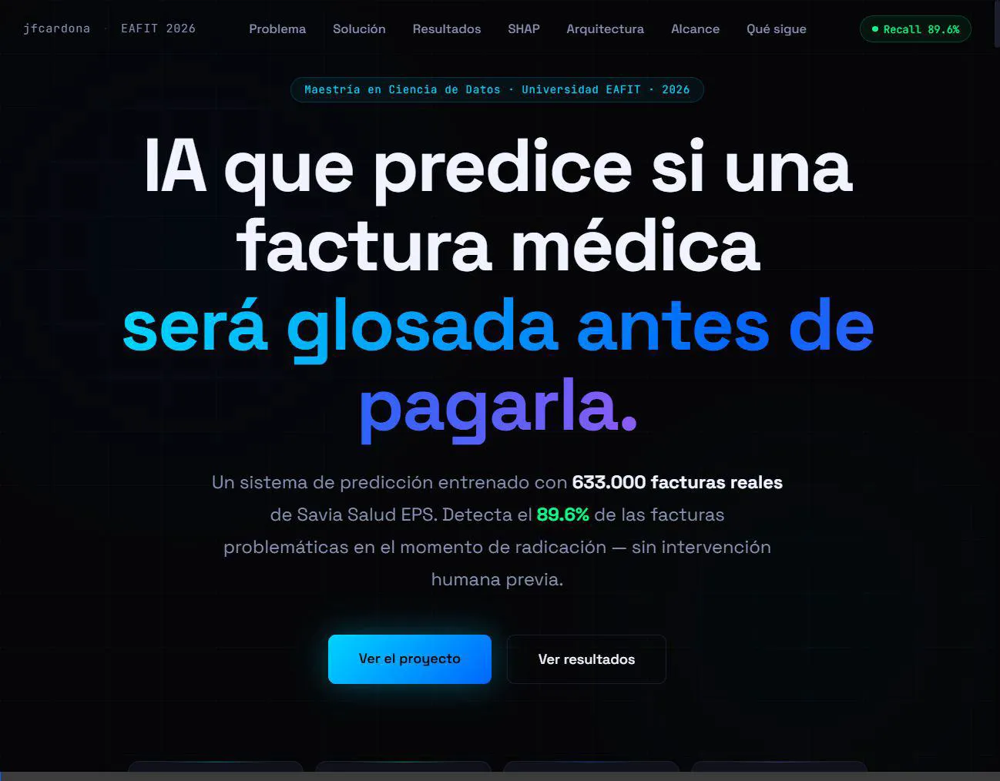

<div align="center">

# 🏥 Predicción de Facturas Médicas con ML
### Detección temprana de glosas en el sistema de salud colombiano

[](https://tesismaestriaeafit.vercel.app)
[](https://tesismaestriaeafit.vercel.app/#resultados)
[](https://tesismaestriaeafit.vercel.app/#resultados)
[](.github/workflows/tests.yml)
[](Codigo/src/api/)
[]()

**Tesis de Maestría en Inteligencia Artificial · EAFIT 2026**  
*Juan Felipe Cardona Arango*

</div>

---

## 🎥 Demo en vivo

> El sistema completo está desplegado como producto real — no como experimento.



🔗 **[Ver sitio completo → tesismaestriaeafit.vercel.app](https://tesismaestriaeafit.vercel.app)**

---

## 🔍 El Problema

En Colombia, las EPS enfrentan un ciclo vicioso de auditoría reactiva:

- Las facturas médicas se pagan **sin revisión previa**
- Las glosas se detectan **90+ días después** del servicio
- El proceso de recobro consume recursos humanos masivos
- El sistema pierde millones de pesos en glosas no recuperadas

> *El médico auditor no puede revisar miles de facturas — necesita saber cuáles revisar primero.*

---

## 💡 La Solución

Un modelo predictivo XGBoost entrenado sobre **datos reales de producción** que predice qué facturas tienen alta probabilidad de ser glosadas — **antes** de que ocurra la auditoría.

```
Factura XML/JSON  →  PrivacyGuard  →  Feature Engineering  →  XGBoost  →  Score + SHAP  →  API REST
```

**No reemplaza al auditor médico. Lo potencia.**

### Lo que encontramos (EDA)
- **554 tablas** en la base de datos de producción de Savia Salud EPS
- **728,000 filas** extraídas con JOINs validados
- **87.3% facturas auditadas** vs 12.7% glosadas — clase desbalanceada tratada con SMOTE
- La IA previa del mercado tenía menos del 60% de precisión real en validación OOT

---

## 📊 Resultados

| Métrica | v1 (baseline) | v2 (ajustado) |
|---------|--------------|---------------|
| **Recall** | 82.1% | **89.6%** ✅ |
| AUC-ROC | 0.891 | **0.908** |
| F1-Score | 0.714 | **0.749** |
| Precisión | 69.3% | 67.8% |

> El objetivo era maximizar Recall — detectar el mayor número de glosas posibles, minimizando las que se escapan.

---

## 🏗️ Arquitectura

```
┌─────────────────── AWS EC2 (t3.medium) ───────────────────┐
│                                                             │
│   FastAPI + Uvicorn                                         │
│   ├── POST /predict          → Score individual            │
│   ├── POST /predict/batch    → Lotes de facturas           │
│   ├── POST /explain          → SHAP waterfall              │
│   └── GET  /health           → Healthcheck                  │
│                                                             │
│   XGBoost JSON  ←→  SHAP TreeExplainer                      │
└───────────────────────────────────────────────────────────┘
         ↑                          ↓
    S3 (modelos)          CloudWatch (drift monitoring)
```

---

## 📁 Estructura del Proyecto

```
Prediccion-Facturas-XML-JSON/
│
├── Codigo/
│   ├── notebooks/           # 9 notebooks: EDA → Feature Eng → Modelado → SHAP
│   ├── src/
│   │   ├── features/        # engineering.py — 48 features validadas
│   │   ├── models/          # predict.py — XGBoost JSON, predict_single/batch
│   │   ├── explainability/  # shap_explanations.py — TreeExplainer en español
│   │   └── api/             # FastAPI: main.py + schemas.py (Pydantic v2)
│   ├── tests/               # 147 tests · 96.85% cobertura
│   └── data/
│       └── processed/       # Train 515K · Val 78K · Test 40K (Parquet)
│
├── web-next/                # Sitio web de presentación (Next.js 16 + Turbopack)
│   ├── app/                 # layout.tsx, page.tsx, globals.css
│   └── components/          # Hero, Problema, Solucion, Resultados, SHAP, Infra...
│
├── models/artifacts/
│   └── 20260309_xgboost_v1.json   # Mejor modelo — AUC 0.908
│
├── Dockerfile               # python:3.11-slim · healthcheck · uvicorn :8000
├── requirements.txt
└── .github/workflows/
    └── tests.yml            # CI: unit · integration · coverage ≥80%
```

---

## 🚀 Uso rápido

### Predecir una factura

```bash
curl -X POST https://api.tesis-eafit.com/predict \
  -H "Content-Type: application/json" \
  -d '{"valor_total": 4500000, "dias_estancia": 12, ...}'
```

```json
{
  "prediction": "GLOSADA",
  "probability": 0.91,
  "risk_level": "ALTO",
  "top_factors": [
    {"feature": "valor_total", "impact": +0.34},
    {"feature": "dias_estancia", "impact": +0.21}
  ]
}
```

### Levantar localmente

```bash
git clone https://github.com/Vagarh/Prediccion-Facturas-XML-JSON.git
cd Prediccion-Facturas-XML-JSON

# Con Docker
docker build -t tesis-api .
docker run -p 8000:8000 tesis-api

# O directo
pip install -r requirements.txt
uvicorn Codigo.src.api.main:app --reload
```

### Correr tests

```bash
cd Codigo
pytest --cov=src --cov-report=term-missing -v
# 147 tests · 96.85% coverage ✅
```

---

## 🧠 Explicabilidad (SHAP)

Cada predicción incluye una explicación en lenguaje natural generada por SHAP TreeExplainer:

> *"Esta factura fue marcada como glosada principalmente porque su valor es 3× el promedio del prestador y la estancia fue 2.4× más larga de lo esperado para el diagnóstico."*

---

## 🛡️ MLOps — Detección de Drift

El sistema monitorea degradación del modelo en producción con alertas automáticas via CloudWatch cuando el PSI (Population Stability Index) supera el umbral crítico de 0.2.

---

## 👤 Autor

**Juan Felipe Cardona Arango**  
Maestría en Inteligencia Artificial · EAFIT 2026  
`felipe.cardona@saviasaludeps.com` · [GitHub @Vagarh](https://github.com/Vagarh)

---

<div align="center">
<sub>Construido con XGBoost · FastAPI · SHAP · Next.js · AWS · Docker</sub>
</div>
